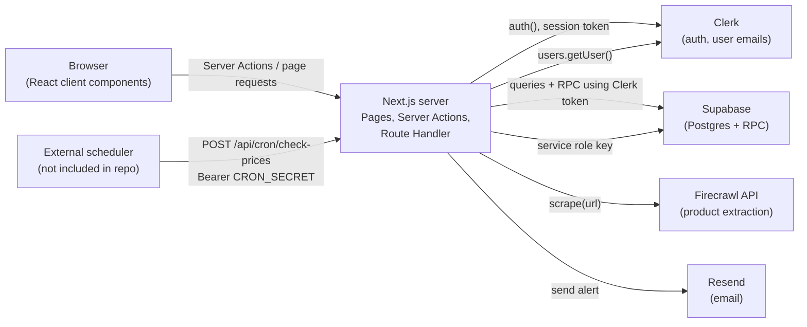
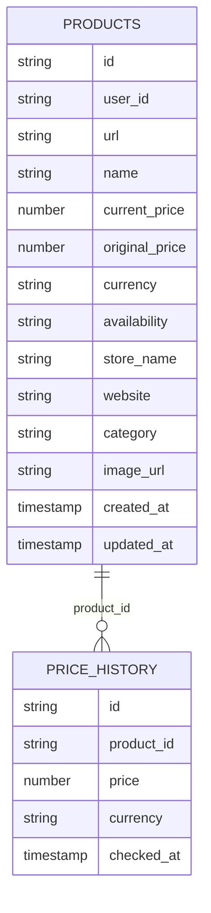

<div align="center">

# DealDrop — Smart Price Tracker

</div>

<div align="center">

[](https://nextjs.org/)
[](https://react.dev/)
[](https://tailwindcss.com/)
[](https://clerk.com/)
[](https://supabase.com/)
[](https://www.firecrawl.dev/)
[](https://resend.com/)

</div>

DealDrop is a full-stack web application for saving product URLs, extracting product details, tracking prices, viewing recorded price history, and receiving email alerts when a scheduled check detects a lower price. It is built with the Next.js App Router and relies on external Clerk, Supabase, Firecrawl, and Resend services.

## Problem Statement

Online shoppers may have to revisit product pages to see whether prices have changed. DealDrop consolidates saved product links and displays their extracted details and recorded price history in one application. A manual refresh can update a tracked product, while a separately triggered scheduled check can send an email when it sees a lower price than the value currently stored in the database.

## Key Features

- **🔐 Authentication:** Sign up and Sign in with Clerk. Product pages and all Server Actions require a signed-in user.
- **🤖 Automatic product extraction:** Paste a URL and Firecrawl returns name, price, currency, image, store, category, and availability as structured data.
- **✅ Input and data validation:** URLs are validated and normalized, scraped data is validated before saving, and duplicate products per user are rejected.
- **📈 Price history chart:** An interactive Recharts line chart of recorded prices for each product.
- **🔄 Manual price refresh:** Re-check a single product's price from the UI. A history entry is recorded only when the price changes.
- **🗂️ Filter, sort, and paginate:** Filters by store/website, category, availability, current-price range, and discount relative to the stored original price. Products can be sorted by recent/oldest creation, last update, or price.
- **📧 Price-drop emails:** `POST /api/cron/check-prices` checks product URLs and can email the user's primary Clerk email when a lower price is detected. An external scheduler must call this endpoint.
- **📱 Responsive UI:** React components, Tailwind CSS, Lucide icons, and Sonner toast notifications provide the UI and interaction feedback.

## Real-World Use Cases

- **🛍️ Keep a personal watchlist:** Save links to products you may want to buy later and review them from your product list.
- **📈 Inspect price movement:** Open a product's detail page to review price history entries recorded at creation and after successful manual price updates.
- **🔄 Refresh before buying:** Manually check the latest extracted price instead of relying on an outdated stored value.
- **🛒 Manage Products in One Place:** Track products from different online stores through a single dashboard.
- **📧 Receive scheduled alerts:** Receive email notifications when the prices of tracked products decrease.
- **🔎 Review and organize products:** Filter and sort saved items by website, availability, category, price range, or discount relative to the original price.

## Tech Stack

| Technology        | Purpose                                                                      |
| ----------------- | ---------------------------------------------------------------------------- |
| ⚡ `Next.js`      | Routing, server components, Server Actions, one Route Handler                |
| ⚛️ `React`        | Component-based user interface                                               |
| 🎨 `Tailwind CSS` | Utility styling and animations                                               |
| 🧩 `shadcn/ui`    | UI component setup and styling conventions                                   |
| 🗄️ `Supabase`     | Postgres database for products and price history, reads/writes, RPC calls    |
| 🔐 `Clerk`        | Authentication, user sessions, route protection, and email lookup for alerts |
| 🕷️ `Firecrawl`    | AI-powered structured product extraction from URLs                           |
| 🖼️ `Lucide React` | Interface Icons                                                              |
| 🔔 `Sonner`       | Toast notifications                                                          |
| 📊 `Recharts`     | Price history line chart                                                     |
| 📧 `Resend`       | Price-drop notification emails                                               |
| ☁️ `Vercel`       | Deployment                                                                   |

## System Architecture and Data Flow

The app uses the Next.js App Router. Pages render UI, product operations run through Next.js Server Actions in `app/actions/product.js`; the scheduled check is a single Route Handler. Supabase access for normal user operations uses the Clerk session token, while the cron handler uses the Supabase service-role key.



### Add-product flow

1. `AddProductForm` sends the URL to the `addProduct` Server Action.
2. The action checks the Clerk user ID, normalizes the URL, and checks for an existing product for that user.
3. `lib/firecrawl.js` asks Firecrawl for structured product fields.
4. `validateScrapedProduct` validates the extracted data; adding a product requires a product name, a valid non-negative price, a store name, and a website value. Currency is normalized to a three-letter value and defaults to `INR` if extraction leaves it empty.
5. The action calls Supabase RPC `create_product_with_history` and revalidates the home and product-list paths.

### Manual refresh flow

1. `updateProductPrice` fetches a product scoped to the authenticated user and scrapes its URL again.
2. If the price is unchanged, the action returns without calling the update RPC or recording history.
3. If the price changed, it calls `update_product_price_with_history` and revalidates the relevant pages.

### Scheduled check flow

The cron route validates `Authorization: Bearer <CRON_SECRET>`, uses `SUPABASE_SERVICE_ROLE_KEY` to read the product table, then checks each URL sequentially. If the scraped price is lower than the stored `current_price`, it looks up the user's primary Clerk email and calls Resend. **The current route does not call `update_product_price_with_history` or otherwise update the product/history tables.**

The `proxy.js` file runs `clerkMiddleware()` for matched requests. Authentication checks are also performed in the protected pages and Server Actions.

## Folder Structure

```text id="w19emm"
smart-price-tracker/
├── app/
│   ├── (auth)/
│   │   ├── layout.js
│   │   ├── sign-in/[[...sign-in]]/page.js
│   │   └── sign-up/[[...sign-up]]/page.js
│   ├── actions/
│   │   └── product.js                # Product Server Actions
│   ├── api/cron/check-prices/
│   │   └── route.js                  # GET status + authenticated POST check
│   ├── products/
│   │   ├── [id]/page.js              # Product detail + price history
│   │   └── page.js                   # Product list, filters, sorting, pagination
│   ├── favicon.ico
│   ├── globals.css
│   ├── layout.js                     # Root layout, Clerk provider, toaster
│   └── page.js                       # Home page and add-product form
├── components/                       # Application UI and components
├── lib/
│   ├── products/
│   │   ├── filters.js                # Filter input normalization
│   │   ├── priceChecker.js           # Compare stored and scraped prices
│   │   ├── scraper.js                # Scraping result wrapper
│   │   ├── service.js                # Supabase queries and RPC calls
│   │   └── validation.js             # URL and scraped data validation
│   ├── data.js                       # Feature and filter/sort options
│   ├── email.js                      # Resend email template and sending
│   ├── firecrawl.js                  # Firecrawl client and extraction schema
│   └── utils.js                      # Formatting, normalization, page size
├── public/
│   └── dealdrop-logo.png
├── supabase/
│   └── server.js                     # Clerk-token Supabase client
├── proxy.js                          # Clerk middleware matcher
├── components.json                   # UI component configuration
├── eslint.config.mjs
├── jsconfig.json                     # @/* path alias
├── next.config.mjs                   # Remote HTTPS image configuration
├── package.json
├── package-lock.json
├── postcss.config.mjs
```

## Database Schema

#### **`products`**

| Field            | Type      | Description                             |
| ---------------- | --------- | --------------------------------------- |
| `id`             | uuid      | Unique product ID                       |
| `user_id`        | uuid      | ID of the product owner                 |
| `url`            | text      | Product page URL                        |
| `name`           | text      | Product name                            |
| `current_price`  | numeric   | Current product price                   |
| `original_price` | numeric   | Original product price                  |
| `currency`       | text      | Product price currency (USD, INR, etc.) |
| `availability`   | text      | Product availability status             |
| `store_name`     | text      | Name of the online store                |
| `website`        | text      | Website where the product is listed     |
| `category`       | text      | Product category                        |
| `image_url`      | text      | Product image URL                       |
| `created_at`     | timestamp | Date tracking started                   |
| `updated_at`     | timestamp | Date of the last update                 |

#### `price_history`

| Field        | Type      | Description                                     |
| ------------ | --------- | ----------------------------------------------- |
| `id`         | uuid      | Primary key                                     |
| `product_id` | uuid      | ID of the tracked product (foreign key)         |
| `price`      | numeric   | Recorded product price                          |
| `currency`   | text      | Currency of the recorded price (USD, INR, etc.) |
| `checked_at` | timestamp | Date and time when the price was recorded       |

### Stored procedures called via `supabase.rpc`

| Function                            | Parameters                                                                                                                                  | Used for                                                                                              |
| ----------------------------------- | ------------------------------------------------------------------------------------------------------------------------------------------- | ----------------------------------------------------------------------------------------------------- |
| `create_product_with_history`       | `p_user_id, p_url, p_name, p_current_price, p_currency, p_original_price, p_availability, p_image_url, p_store_name, p_website, p_category` | Insert product and first history row. Code treats Postgres error `23505` as a duplicate-product error |
| `update_product_price_with_history` | `p_user_id, p_product_id, p_current_price, p_currency, p_product_name, p_image_url, p_availability`                                         | Update product and append history. Code treats error `P0002` as "not found"                           |

### Inferred relationship



## API Reference

#### `GET /api/cron/check-prices`

**Example**

```bash id="3g60xu"
curl http://localhost:3000/api/cron/check-prices
```

**Response (`200 OK`)**

```json id="84s3a7"
{
  "success": true,
  "message": "Price check endpoint is working. Use POST to trigger."
}
```

#### `POST /api/cron/check-prices`

Runs a check for products read from the `products` table using the Supabase service-role key. It loads the product rows and processes them sequentially. There is no request body.

**Example**

```bash
curl -X POST http://localhost:3000/api/cron/check-prices \
  -H "Authorization: Bearer $CRON_SECRET"
```

**Success (`200`)**

```json id="pk7kze"
{
  "success": true,
  "message": "Price check completed.",
  "results": {
    "total": 0,
    "checked": 0,
    "updated": 0,
    "failed": 0,
    "priceChanges": 0,
    "priceDrops": 0,
    "alertsSent": 0,
    "alertsFailed": 0
  }
}
```

**Error responses implemented by the route**

| Status | Response `error`                     | Condition                                                             |
| ------ | ------------------------------------ | --------------------------------------------------------------------- |
| `401`  | `Unauthorized`                       | Missing or wrong `Authorization` header                               |
| `500`  | `Cron secret is not configured.`     | `CRON_SECRET` is empty/unset.                                         |
| `500`  | `Supabase configuration is missing.` | `NEXT_PUBLIC_SUPABASE_URL` or `SUPABASE_SERVICE_ROLE_KEY` is missing. |
| `500`  | `Price check failed.`                | An unhandled top-level error, such as failure to read products.       |

### Product Server Actions

| Server Action                   | Input                  | Behavior and result shape                                                                                                                                                         |
| ------------------------------- | ---------------------- | --------------------------------------------------------------------------------------------------------------------------------------------------------------------------------- |
| `addProduct(formData)`          | `formData` with `url`  | Validates and extracts product data, checks for duplicates, calls the create RPC, and returns an object with `success`; on success, `product` and `message`; on failure, `error`. |
| `deleteProduct(productId)`      | Product ID string      | Deletes only a product matching both the ID and current Clerk user ID. Returns `success` and `message` or `error`.                                                                |
| `updateProductPrice(productId)` | Product ID string      | Scrapes latest data. If changed, invokes the update/history RPC; if unchanged, returns `success: true` with `priceChanged: false` and `historyRecorded: false`.                   |
| `getProducts(options)`          | Optional filter object | Returns `success` and `data` containing `products` and `total`, or an error object. Defaults include `page: 1`, `limit: 9`, and `sort: "recent"`.                                 |
| `getProductById(id)`            | Product ID string      | Returns the product and `priceHistory` in `data`, or an error object.                                                                                                             |

## External Integrations

| Service       | Purpose                                                                                                       | Code location / configuration notes                                                                                                                                                 |
| ------------- | ------------------------------------------------------------------------------------------------------------- | ----------------------------------------------------------------------------------------------------------------------------------------------------------------------------------- |
| **Clerk**     | Sign-up/sign-in, user identity and session token, protected-page checks, and primary-email lookup for alerts. | `app/layout.js`, `proxy.js`, auth pages, Server Actions, and the cron route. The app expects Clerk publishable and secret keys in its environment.                                  |
| **Supabase**  | Postgres storage and RPC functions for product and price-history data.                                        | `supabase/server.js` creates the user-operation client with the Clerk session token; the cron route creates a separate client with `SUPABASE_SERVICE_ROLE_KEY`.                     |
| **Firecrawl** | Retrieves structured product information from submitted product URLs.                                         | `lib/firecrawl.js` defines a JSON output schema and extraction prompt; `lib/products/scraper.js` wraps failures.                                                                    |
| **Resend**    | Sends price-drop notification emails.                                                                         | `lib/email.js` contains the HTML template and reads the sender and API key from environment variables. The scheduled route looks up the primary email through Clerk before sending. |

## Environment Variables

#### Example `.env`

```bash
# Clerk
NEXT_PUBLIC_CLERK_PUBLISHABLE_KEY=pk_test_xxx
CLERK_SECRET_KEY=sk_test_xxx

# Supabase
NEXT_PUBLIC_SUPABASE_URL=https://your-project.supabase.co
NEXT_PUBLIC_SUPABASE_PUBLISHABLE_KEY=your-supabase-publishable-key
SUPABASE_SERVICE_ROLE_KEY=your-supabase-service-role-key

# Firecrawl
FIRECRAWL_API_KEY=your-firecrawl-api-key

# Resend
RESEND_FROM_EMAIL=alerts@yourdomain.com
RESEND_API_KEY=your-resend-api-key

# Cron
CRON_SECRET=a-long-random-shared-secret

# App
NEXT_PUBLIC_APP_URL=http://localhost:3000
```

## Prerequisites

- **Node.js ≥ 20.9.0**: Required by the installed Next.js version.
- **npm**: Used to install dependencies (`package-lock.json` is included in the repository).
- **Service accounts and API credentials**: for Clerk, Supabase, Firecrawl, and Resend.
- **Supabase database setup**: A Supabase project with the `products` and `price_history` tables and the `create_product_with_history` and `update_product_price_with_history` RPC functions.
- **Clerk–Supabase integration**: Supabase must be configured to accept Clerk-issued session tokens for authenticated database access.

## Installation and Local Setup

1. **Clone the repository**

```bash
git clone https://github.com/jyothikaogeti/dealdrop-smart-price-tracker.git
cd dealdrop-smart-price-tracker
```

2. **Install dependencies**

```bash
npm install
```

3. **Start the dev server**

```bash
npm run dev
```

4. **Verify locally** by opening <http://localhost:3000>, then:

- Sign up/in via **`Clerk`**.
- Paste a product URL and click **`Track Price`**.
- Open **`My Products`** and the product's detail page.
- Optionally check the cron route: `curl http://localhost:3000/api/cron/check-prices` should return the `GET` status JSON.

## Available Scripts

The following scripts are defined in `package.json`:

| Command         | Purpose                                                    |
| --------------- | ---------------------------------------------------------- |
| `npm run dev`   | Starts the Next.js development server.                     |
| `npm run build` | Creates a production build.                                |
| `npm run start` | Serves the production build; run after a successful build. |
| `npm run lint`  | Runs ESLint using the repository's ESLint configuration.   |

## Deployment

- Build and start with `npm run build` and `npm start` on Node ≥ 20.9.0.
- Set all `environment variables `in the host. Set `NEXT_PUBLIC_APP_URL` to the production URL.
- The Supabase schema and functions must exist in the production project.
- The cron route uses `export const runtime = "nodejs"`.

Schedule an HTTP `POST` to `/api/cron/check-prices` with `Authorization: Bearer <CRON_SECRET>` using Supabase Cron Jobs.

## Troubleshooting

| Symptom                                               | Likely Cause / Solution                                                                                                               |
| ----------------------------------------------------- | ------------------------------------------------------------------------------------------------------------------------------------- |
| **Clerk authentication fails**                        | Verify the Clerk publishable key and secret key in `.env.local`. Restart the development server after changing environment variables. |
| **Product actions fail or products cannot be loaded** | Verify `NEXT_PUBLIC_SUPABASE_URL`, the Supabase key, database tables, and Row Level Security (RLS) policies.                          |
| **Product extraction fails**                          | Verify `FIRECRAWL_API_KEY` and check server logs to identify extraction failures.                                                     |
| **Product creation or manual price refresh fails**    | Ensure the `create_product_with_history` and `update_product_price_with_history` RPC functions exist with compatible argument names.  |
| **`POST /api/cron/check-prices` returns `401`**       | Verify that the request includes `Authorization: Bearer <CRON_SECRET>` and that the secret matches the configured value.              |
| **Price-drop emails are not received**                | Check `RESEND_API_KEY`, `RESEND_FROM_EMAIL`, the user's primary Clerk email, and Resend delivery logs.                                |
| **Build or dependency installation fails**            | Verify the Node.js version (`>=20.9.0`), install dependencies, and inspect the build logs.                                            |

## Learning Outcomes

- **Full-stack development:** Building an application using the Next.js App Router and React.
- **Authentication:** Integrating Clerk authentication with server-side application logic.
- **Database operations:** Using Supabase PostgreSQL and RPC functions for product and price-history management.
- **External API integration:** Extracting structured product information using Firecrawl.
- **Data validation:** Validating URLs and extracted product information before saving data.
- **Email notifications:** Creating transactional email notifications using Resend.
- **Data visualization:** Displaying recorded price changes with Recharts.
- **Application security:** Handling environment variables, server-side credentials, and user-scoped data access.
- **Documentation:** Writing setup instructions, API references, and troubleshooting guidance for developers.
